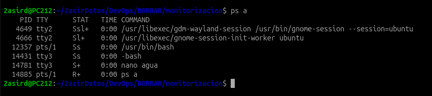
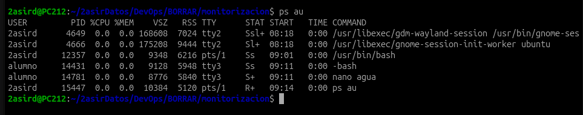
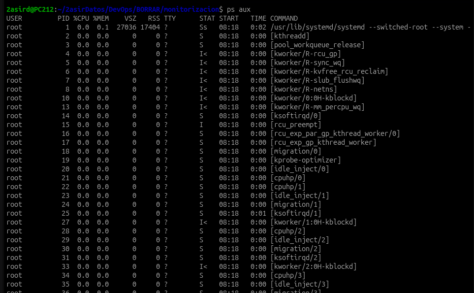
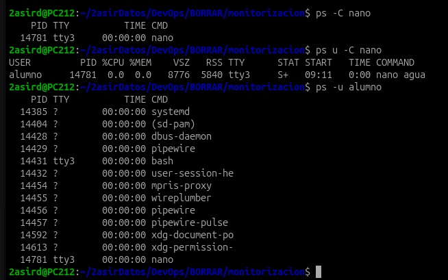
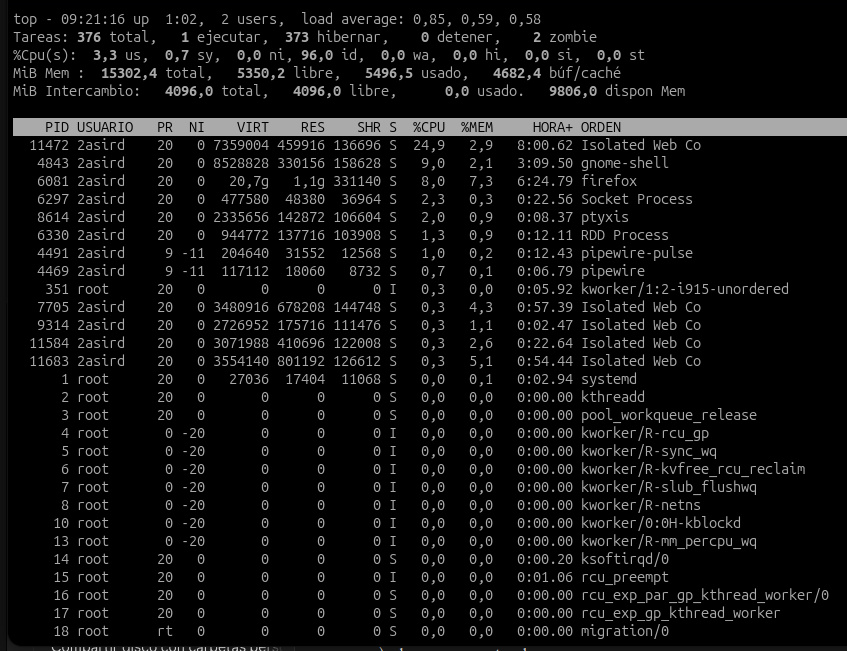
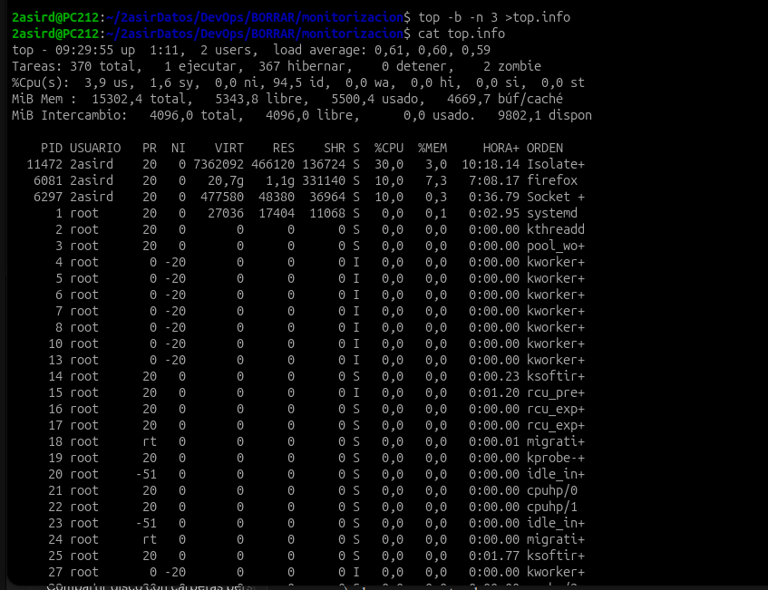
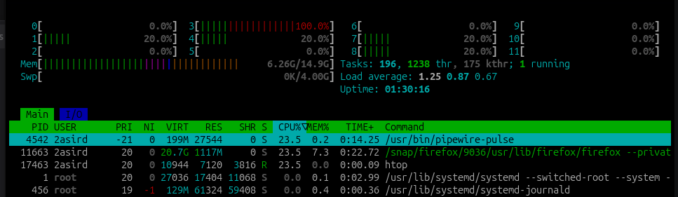
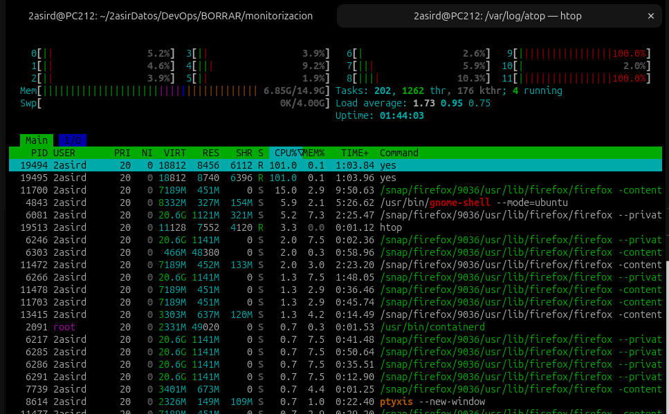

# 1. Procesos

[⬅️ Volver al índice](../README.md)

Herramientas para ver qué se está ejecutando en el sistema y cuántos recursos consume cada proceso.

| Herramienta | Tipo | Cuándo usarla |
|-------------|------|---------------|
| `ps` | Foto fija | Ver los procesos en un instante concreto |
| `top` | Tiempo real | Ver qué consume más CPU/RAM ahora mismo |
| `htop` | Tiempo real (visual) | Lo mismo que `top`, más cómodo de usar |
| `atop` | Tiempo real + historial | Saber qué pasó en el sistema hace horas |

---

## 1.1 `ps` — Procesos activos

Muestra información de los procesos activos **en el momento en que se ejecuta** (no se actualiza).

> 💡 `ps` acepta dos estilos de opciones: **BSD** (sin guion: `ps aux`) y **UNIX** (con guion: `ps -u alumno`). No es lo mismo `ps u` que `ps -u`.

### Opciones principales

| Opción | Qué hace |
|--------|----------|
| `a` | Procesos de **todos los usuarios** que tienen terminal |
| `u` | Formato orientado al **usuario** (añade USER, %CPU, %MEM...) |
| `x` | Incluye los procesos **sin terminal** (servicios, demonios) |
| `-u usuario` | Procesos de un usuario concreto |
| `-C nombre` | Procesos con ese nombre de comando |

### `ps a`



### `ps au`

Lo mismo, pero con columnas de usuario y consumo:



### `ps aux`

Todos los procesos del sistema, tengan terminal o no. Es el más usado:



### `ps -C`, `ps u -C` y `ps -u`

Filtrar por nombre de comando (`nano`) y por usuario (`alumno`):



### Columnas importantes

| Columna | Significado |
|---------|-------------|
| `PID` | Identificador del proceso |
| `USER` | Usuario propietario |
| `%CPU` / `%MEM` | Porcentaje de CPU y RAM que usa |
| `VSZ` | Memoria virtual total (KiB) |
| `RSS` | Memoria física real que ocupa (KiB) |
| `TTY` | Terminal asociada (`?` = ninguna, es un servicio) |
| `STAT` | Estado del proceso (ver abajo) |
| `START` / `TIME` | Hora de inicio / tiempo total de CPU usado |

<details>
<summary><b>Códigos de la columna STAT</b></summary>

| Código | Significado |
|--------|-------------|
| `R` | Ejecutándose (*running*) |
| `S` | Dormido, esperando algo (*sleeping*) |
| `I` | Hilo del kernel inactivo (*idle*) |
| `Z` | Zombie: terminó pero su padre no ha recogido su estado |
| `T` | Detenido |
| `s` | Líder de sesión |
| `+` | En primer plano en su terminal |
| `l` | Multihilo |
| `<` | Prioridad alta |

</details>

---

## 1.2 `top` — Procesos en tiempo real

Muestra los procesos ordenados por consumo y se actualiza continuamente.



### La cabecera

| Línea | Qué dice |
|-------|----------|
| `top - ... up ... load average` | Hora, tiempo encendido, usuarios y **carga media** del último 1, 5 y 15 min |
| `Tareas` | Procesos totales y en qué estado están (fíjate en los **zombie**) |
| `%Cpu(s)` | `us` usuario · `sy` sistema · `id` inactivo · `wa` esperando disco |
| `MiB Mem` / `Intercambio` | RAM y swap |

### Teclas en modo interactivo

| Tecla | Ordena por |
|-------|------------|
| `M` | Memoria |
| `P` | Consumo de CPU |
| `T` | Tiempo de uso |
| `N` | PID |
| `R` | Invierte el orden (de menor a mayor) |

### Modo no interactivo (batch)

```bash
top -b -n 3 > top.info
```

- `-b` → modo *batch*: no interactivo, apto para redirigir a un archivo
- `-n 3` → 3 iteraciones y termina

Resultado guardado en [`top.info`](../top.info):



### 📝 Ejercicio

> Utilizando el comando `top`, necesitamos mandar a nuestro jefe de proyecto un listado de los **10 procesos que consumen más CPU** durante **3 periodos consecutivos**.

```bash
top -b -n 3 -o %CPU | grep -A 10 "PID" > top10_cpu.txt
```

| Parte | Qué hace |
|-------|----------|
| `top -b -n 3` | 3 iteraciones en modo batch |
| `-o %CPU` | Ordena por consumo de CPU |
| `grep -A 10 "PID"` | Coge la línea de cabecera (la que contiene `PID`) y las **10 siguientes** |
| `> top10_cpu.txt` | Guarda el resultado en un archivo |

> ⚠️ `grep` separa cada bloque con una línea `--`. Es normal.

---

## 1.3 `htop` — `top` mejorado

Misma idea que `top`, pero con barras de colores por núcleo, ratón, scroll y teclas de función. No suele venir instalado:

```bash
sudo apt install htop
```



Prueba de carga con dos procesos `yes` (cada uno pone un núcleo al 100 %):



---

## 1.4 `atop` — Monitor con historial

A diferencia de `ps`, `top` y `htop`, **`atop` se instala como servicio**: se queda ejecutándose en segundo plano aunque no lo abras y va guardando registros del sistema en `/var/log/atop/`.

Eso permite ver **qué pasó en el pasado** (por ejemplo, qué proceso disparó la CPU de madrugada).

```bash
sudo apt install atop
atop                                  # modo interactivo, como top
atop -r /var/log/atop/atop_AAAAMMDD   # reproducir el registro de un día
```

| Archivo | Para qué |
|---------|----------|
| `/etc/default/atop` | Configuración del servicio (cada cuánto registra, dónde guarda...) |
| `/var/log/atop/` | Registros históricos |

---

[⬅️ Volver al índice](../README.md) · [Siguiente: Memoria y disco ➡️](2.md)