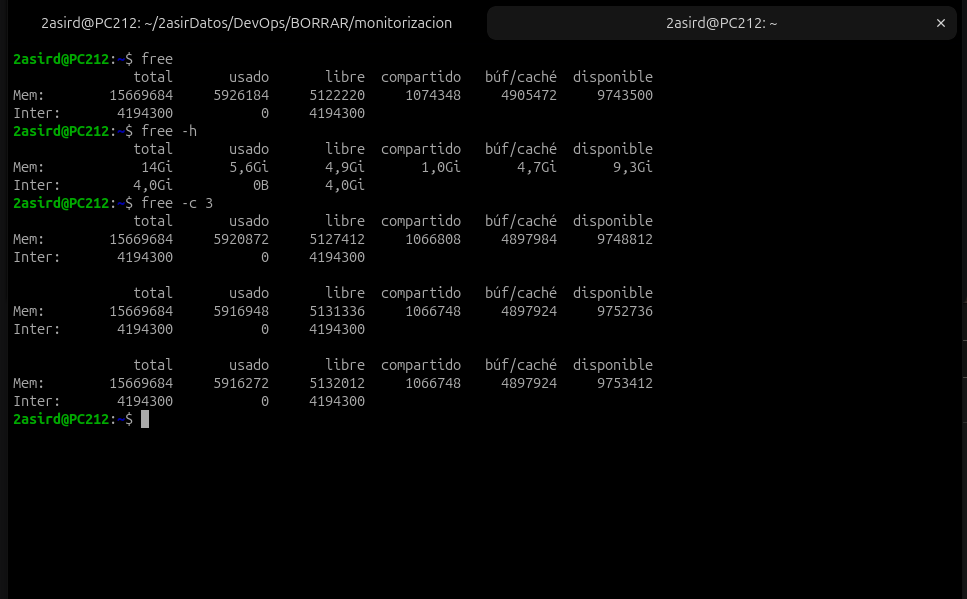
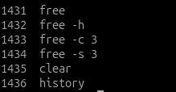
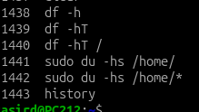

# 2. Memoria, espacio y rendimiento del disco

[⬅️ Volver al índice](../README.md)

| Herramienta | Qué mide |
|-------------|----------|
| `free` | Memoria RAM y swap |
| `df` | Espacio de los sistemas de archivos montados |
| `du` | Espacio que ocupan archivos y carpetas |

---

## 2.1 `free` — Memoria RAM y swap

Muestra la cantidad de memoria libre y utilizada en el sistema.

| Opción | Qué hace |
|--------|----------|
| `-h` | Formato legible (Gi, Mi) en lugar de KiB |
| `-c 3` | Muestra los datos **3 veces** y termina |
| `-s 3` | Repite **cada 3 segundos** (hasta `Ctrl+C`) |

Se pueden combinar: `free -h -s 2 -c 5` → 5 veces, cada 2 segundos, en formato legible.





### Cómo leer la salida

| Columna | Significado |
|---------|-------------|
| `total` | RAM total |
| `usado` | En uso por procesos |
| `libre` | Sin usar para **nada** |
| `compartido` | Memoria compartida entre procesos (tmpfs, etc.) |
| `búf/caché` | Usada por el kernel como caché de disco. **Se libera si hace falta** |
| `disponible` | Lo que realmente pueden usar los programas nuevos |

> 💡 **La columna importante es `disponible`, no `libre`.** Linux usa la RAM sobrante como caché para ir más rápido, así que `libre` siempre parece bajo. En la captura: 4,9 Gi libres pero **9,3 Gi disponibles**.

> 💡 Si `Inter` (swap) tiene uso alto, el sistema se está quedando sin RAM.

---

## 2.2 `df` y `du` — Espacio en disco

### `df` — Sistemas de archivos

Muestra el espacio utilizado y disponible en los sistemas de archivos montados.

```bash
df -h       # formato legible
df -hT      # añade el tipo de sistema de archivos (ext4, tmpfs, vfat...)
df -hT /    # solo la partición donde está montada la raíz
```

### `du` — Archivos y carpetas

Muestra cuánto ocupa una carpeta o archivo.

```bash
sudo du -hs /home/     # total de /home
sudo du -hs /home/*    # cuánto ocupa cada carpeta dentro de /home
```

- `-h` → formato legible
- `-s` → solo el total (*summary*), sin listar cada subcarpeta
- `sudo` → hace falta para leer las carpetas de otros usuarios

> 💡 **`df` = ¿cuánto queda en el disco?** · **`du` = ¿qué es lo que lo está llenando?**



---

[⬅️ Anterior: Procesos](1.md) · [Volver al índice](../README.md)